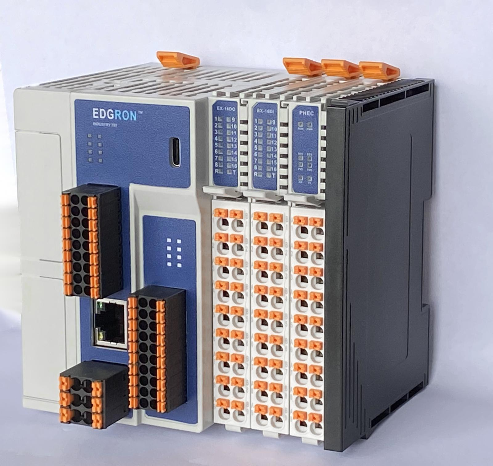
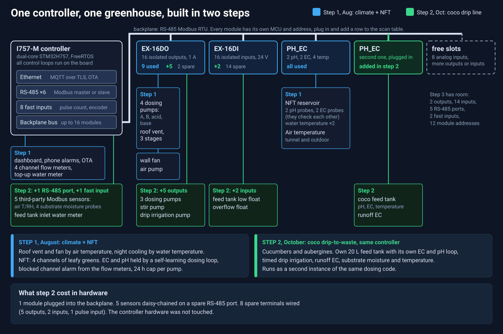
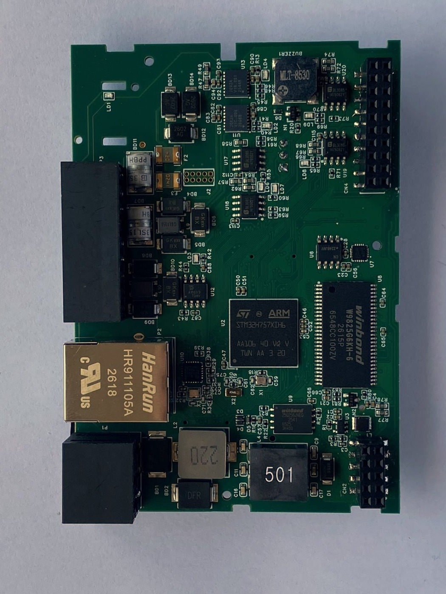
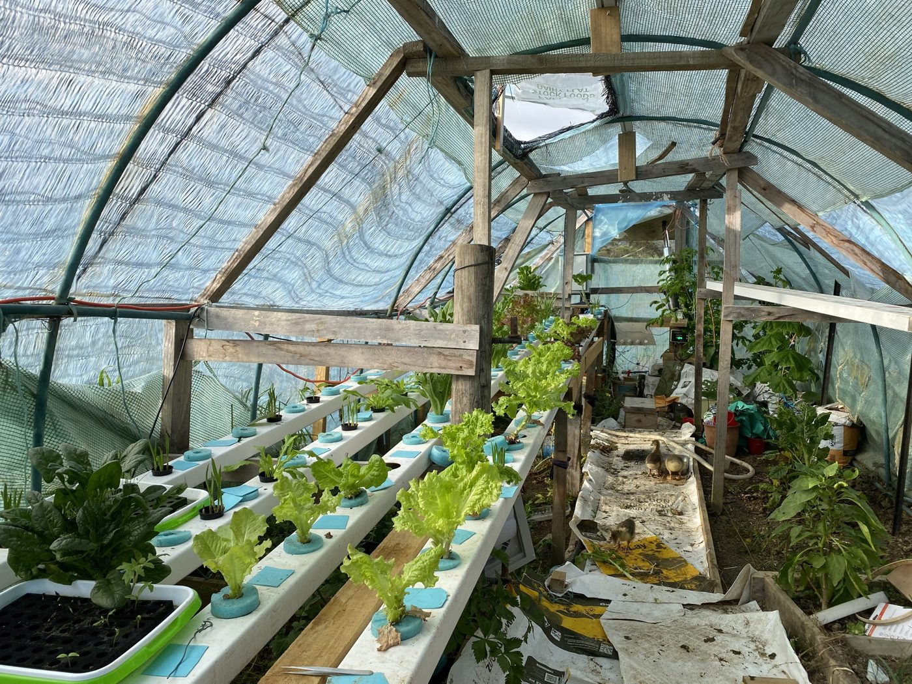

# I757-M: dual-core STM32H757 controller firmware

**Right now this firmware is controlling the water and nutrients of a working hydroponic
greenhouse.** One I757-M doses fertiliser and pH into two reservoirs, runs the irrigation, and opens
the roof vents and fan. It has been in charge there since August 2026, and its readings are public,
live: [dash.edgron.com/public](https://dash.edgron.com/public).

<p align="center">
  
</p>

The complete firmware, manuals and schematics of the **I757-M**, a DIN-rail modular industrial
controller built on the dual-core **STM32H757**. The Cortex-M7 runs FreeRTOS, LwIP, mbedTLS, MQTT,
storage and the application; the Cortex-M4 runs the real-time I/O and every Modbus port; OpenAMP
RPMsg joins them. Write your own application on top of the platform, or leave the firmware alone
and integrate over Modbus or MQTT.

This is not a demo project: it is the same code that ships in the hardware we sell. The running
log of what broke in the greenhouse and what was changed is at
[edgron.com/field.html](https://edgron.com/field.html).

Hardware, pricing and ordering: [edgron.com](https://edgron.com)

## What it is running in the greenhouse

<p align="center">
  <a href="docs/img/greenhouse_control.svg"></a>
</p>

One controller, built up in two steps. In August it took over the climate and an NFT system. In
October a coco drip line was added on the same controller: one more module on the backplane, five
third-party sensors on a spare RS-485 port, and a second instance of the same dosing code. The
application that does all of this is the `app_user.c` in this repository.

## Worth reading even if you never buy the board

Three faults that only showed up in the field, each fixed in a few lines. The comments at each fix
give the full account.

- **A dual-core EXTI trap that reset the board 1318 times.** On the H7 dual-core parts the generic
  `__HAL_GPIO_EXTI_CLEAR_IT()` clears the Cortex-M7's pending register. Called from the Cortex-M4
  it clears the wrong core's bit, the M4's own bit stays set, and the handler re-enters forever.
  The M4 has to use the `__HAL_GPIO_EXTID2_*` macros.
  See [`app_hsdi_cm4.c`](platform_757/CM4/App/app_hsdi_cm4.c), above `exti_edge()`.

- **TCP that would not retransmit for 15 to 45 seconds.** The Ethernet driver template released a
  transmitted buffer only when its four-descriptor ring was full. Until then the driver still held
  a reference to the pbuf, and lwIP will not retransmit a segment whose buffer is still
  referenced. On a quiet MQTT link one lost segment stalled the connection. The fix releases the
  buffer as soon as the frame has gone out.
  See `low_level_output()` in [`ethernetif.c`](platform_757/CM7/LWIP/Target/ethernetif.c).

- **A UART that went deaf for good after one refused restart.** The recovery routine cleared its
  "receiver is dead" flag before checking that the HAL had accepted the re-arm. One refusal, and
  the port never listened again while transmit carried on as normal. It now clears the flag only
  after a re-arm that was accepted, and escalates from re-arm to abort to full re-initialisation
  if refusals continue.
  See `uart_heal()` in [`uart_drv.c`](uartdrv/uart_drv.c) (Apache-2.0, no hardware tie).

Also worth a look: the over-the-air update with a trial period and automatic rollback
([`app_ota.c`](platform_757/CM7/App/app_ota.c), design in
[`docs/OTA_Update_and_Brick_Proofing.md`](docs/OTA_Update_and_Brick_Proofing.md)).

## What the firmware does

- **Cyclic I/O scanning into a process image.** The M4 core polls every Modbus port and the
  backplane from one scan table; your code reads and writes named points without blocking.
- **Your application as ordinary FreeRTOS tasks**, in one file (`platform_757/CM7/App/app_user.c`),
  against one header (`app_platform.h`).
- **Over-the-air updates that cannot brick the board.** Signed images, A/B flash banks, a trial
  period and automatic rollback if the new image does not confirm itself. Module firmware is
  updated over the backplane.
- **Cloud link over MQTT with mutual TLS.** The board publishes a description of its own points, so
  a dashboard needs no per-device code. Leave it out with one switch (`APP_ENABLE_CLOUD 0`) for a
  standalone controller.
- **On-board data logging**: daily CSV files on microSD or the on-board flash, plus an event
  journal, both retrievable over the cloud link.
- **Standard protocols throughout**: Modbus RTU and TCP, MQTT, RPMsg between the cores. Third-party
  tools can talk to every bus, including the backplane.

As shipped, `app_user.c` is not a blank template. It is the greenhouse application: nutrient and pH
dosing for two reservoirs, roof-vent and fan control, a feed-flow alarm, and a scan table of
third-party RS-485 sensors. Read it as a worked example, then replace it with your own
(`CLAUDE.md` lists what to delete).

## The hardware

<p align="center">
  
  &nbsp;
  
</p>

| | |
|---|---|
| MCU | STM32H757XIH6. Cortex-M7 at 480 MHz for network, TLS, storage and your application; Cortex-M4 at 240 MHz for real-time I/O |
| Memory | 2 MB dual-bank flash, 1 MB RAM; 32 MB SDRAM and 32 MB SPI flash on Pro / Full; microSD |
| Field buses | 6 × RS-485 (each Modbus RTU master or slave), 2 × CAN (one isolated), Ethernet (Modbus TCP, MQTT over TLS) |
| On-board I/O | 8 isolated high-speed inputs (DI, counter or encoder), USB-C service console |
| Expansion | Up to 16 modules on a Modbus RTU backplane, discovered automatically |
| Identity | ATECC608A secure element; the device's private key never leaves the chip |
| Supply / size | 9–36 V DC, approx. 90 × 105 × 83 mm, 35 mm DIN rail |

Expansion modules, each of which also works on its own as a plain Modbus RTU slave for any PLC or PC:

| Module | What it is | Manual |
|---|---|---|
| EX-16DO | 16 isolated PhotoMOS outputs, 1 A per channel, AC or DC loads | [manual](docs/EX_16DO_Module_Manual.md) · [schematic](hardware/EX_16DO_Schematic.pdf) |
| EX-16DI | 16 isolated polarity-free inputs, debounce and a 32-bit counter per channel | [manual](docs/EX_16DI_Module_Manual.md) |
| PH_EC | 2 × pH, 2 × EC, 4 × temperature water-quality transmitter | [manual](docs/PH_EC_Transmitter_User_Manual.md) |
| EX-BUS | Passive power and RS-485 entry board for a module row | [manual](docs/EX_BUS_Module_Manual.md) |

Schematics of the controller's two boards and the EX-16DO are in [`hardware/`](hardware/).

## What's here

```
platform_757/        Full buildable dual-core firmware project
├── CM7/             Cortex-M7: network / TLS / MQTT / OTA / storage / application
│   ├── App/         Platform services + YOUR code (write here)
│   ├── Core/        CubeMX-generated (clocks / peripherals / vectors) — don't edit
│   └── Middlewares/ mbedTLS / LwIP / FreeRTOS / littlefs / FatFs
└── CM4/             Cortex-M4: real-time I/O / Modbus / backplane bus master
modbus/              Transport-agnostic Modbus core (RTU + TCP share it)
uartdrv/             Multi-instance UART driver
docs/                Manuals + interface contracts (the authoritative specs)
hardware/            Schematics (PDF): controller main board, Board 2, EX-16DO module
tools/               OTA push / broker setup scripts
```

## Start here

0. **Just received a board?** — `docs/Unboxing_and_First_Power_Up.md` (power, USB console, network,
   dashboard, and the things a fresh board does that are not faults). Working with an AI coding
   assistant? `CLAUDE.md` at the repo root is the fast path into the code.
0b. **Using expansion modules without the controller** (plain Modbus slaves for your PLC/PC) —
   `docs/Expansion_Modules_Standalone_Quick_Start.md` + `tools/u485_quickstart.py`.
1. **Hardware & installation** — `docs/i757_Controller_Manual.md` (controller: specs, wiring, operation);
   expansion modules have their own manuals, linked in the table above
2. **Software / how to develop your app** — `docs/Software_Manual_Application_Development.md`
   (where to write code, how to call platform services, a worked example)
3. **Interface contracts** — the `docs/*.md` specs (cloud protocol, Modbus, backplane, RPMsg, security, …)

## Build

```
cd platform_757/CM7 && cmake --preset Debug && cmake --build build/Debug
cd platform_757/CM4 && cmake --preset Debug && cmake --build build/Debug
```
Toolchain: arm-none-eabi-gcc + CMake + Ninja (STM32CubeCLT provides all three).
**No `keys/` folder is needed to build** — see "Configure your broker" below.

## Configure your broker

- **No cloud?** Set `APP_ENABLE_CLOUD 0` in `platform_757/CM7/App/app_cfg.h` for a standalone
  controller (Modbus / I/O / storage / your app tasks, no MQTT). Builds with no broker and no `keys/`.
- **Edgron cloud (the dashboard):** nothing to configure. `app_cfg.h` already points at the Edgron
  broker, the Edgron root CA certificate and the release-signing public key are committed in `certs/`
  (public material, see `certs/README.md`), and the board's own mTLS identity lives in its ATECC608A
  plus the identity partition written at the factory — it survives any reflash and is never part of
  a build. Build, flash, and the board appears on the dashboard.
- **Your own broker:** set `CFG_MQTT_PUB_HOST` in `app_cfg.h` (an IP literal) and put your CA
  certificate in a `keys/ca/` directory next to the repo (`keys/` wins over `certs/` when present; it
  is git-ignored). Guide for AWS IoT: `docs/Connect_Your_Own_AWS_IoT.md`.

## Security note

This SDK contains **no secrets**: no broker passwords, no private keys, no device
certificates (those are build-generated from your own `keys/`). Each device's mTLS
private key is generated inside and never leaves the ATECC608A — it cannot be copied.

The two files in [`certs/`](certs/) are public on purpose: a root CA certificate and a
firmware-signing **public** key, there so that a fresh checkout builds and connects without any
setup. Their private halves are not in this repository.

## License

**Source-available, not restricted for personal use.** Edgron-authored code and documents are
under the [Edgron Source-Available License](LICENSE):

- read, study, modify and redistribute the source freely;
- run it on anything for personal, research, educational or evaluation use;
- **commercial use (selling devices or services that run it) is permitted only on genuine
  Edgron hardware** — building or selling other hardware with this firmware is not;
- your own application code stays yours, no disclosure obligation.

Two pure-software components carry no hardware condition and are plain **Apache-2.0**:
[`modbus/`](modbus/LICENSE) (transport-agnostic Modbus core) and [`uartdrv/`](uartdrv/LICENSE)
(multi-instance UART driver).

Third-party components keep their own licenses: see
[THIRD_PARTY_NOTICES.md](THIRD_PARTY_NOTICES.md), and include those notices with your
product documentation when you ship. "Edgron" and "i757" are trademarks of Edgron; the license
grants no rights to them beyond truthful reference.

## Contributing

Issues and pull requests are welcome. By submitting a contribution you agree that it is licensed
under the same license as the file it modifies.
